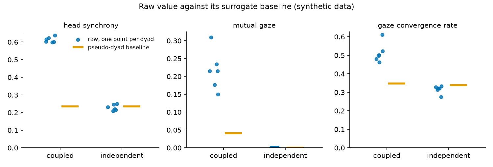

# dyad-sync-metrics

A small Python library for analysing recordings of two people interacting: head and body
motion tracking, eye tracking, interval-coded attention (for example gaze targets coded
from video) and questionnaires. It provides the measures, the chance baselines needed to
interpret them, and exact tests for the very small samples such recordings usually yield.

Everything is tested and demonstrated on synthetic data with known ground truth,
generated at run time. No recorded data ships with the package.

## Contents

- [Why surrogate baselines](#why-surrogate-baselines)
- [Measures](#measures)
- [Surrogates](#surrogates)
- [Small-sample inference](#small-sample-inference)
- [Methods note: sign at the best lag](#methods-note-sign-at-the-best-lag)
- [Installation and quick start](#installation-and-quick-start)
- [Demo and tests](#demo-and-tests)
- [Limitations](#limitations)

## Why surrogate baselines

Two people sitting face to face share a setting. They move at similar tempos, look toward
each other, and look into the same workspace, whether or not anything is coordinated
between them. A raw dyadic value therefore mixes coordination with structure the setting
imposes, and comparing raw values between conditions can mistake one for the other.

A surrogate baseline estimates the structural share from pairs that cannot be coordinated
(see [Surrogates](#surrogates)); the corrected value is observed minus baseline. The
synthetic example below shows both effects. Six dyads of 120 s each are generated in two
conditions. In `coupled`, person 2 follows person 1's movement and the pair looks at each
other and at shared objects more often than chance. In `independent`, the two people
move and choose gaze targets independently (the gaze parameters are in
[`examples/demo.py`](examples/demo.py)). Values are means over dyads:

| Measure | Condition | Raw | Pseudo-dyad baseline | Corrected |
|---|---|---|---|---|
| Head synchrony | coupled | 0.613 | 0.234 | 0.379 |
| Head synchrony | independent | 0.228 | 0.235 | -0.007 |
| Mutual gaze | coupled | 0.217 | 0.041 | 0.176 |
| Gaze-ray convergence rate | coupled | 0.513 | 0.347 | 0.165 |
| Gaze-ray convergence rate | independent | 0.316 | 0.338 | -0.023 |

Independent pairs show a raw synchrony of 0.23, because a lag search over unrelated
movement always finds some correlation, and a raw convergence rate of 0.32, because two
people who pick one of three scene objects independently agree a third of the time. Both
correct to about zero. The test suite asserts the same pattern: with five dyads, raw
synchrony of independent pairs is above 0.1, their corrected value lies within 0.03 of
zero, and every coupled dyad's corrected value exceeds every independent one's.



The figure shows each dyad's raw value (blue) against the baseline of its condition
(orange).

## Measures

All per-frame measures take arrays at a common sampling rate, positions in one world
frame in metres, and angles in degrees. Series of unequal length are truncated to the
shorter one, so a surrogate pair built from two recordings runs through exactly the same
code as a real pair.

### Movement synchrony

`signal.speed` turns a tracked point into a gap-filled, low-pass filtered speed series
(zero-phase Butterworth, 6 Hz by default). `sync.windowed_xcorr` cuts two series into
overlapping windows (30 s, 50 % overlap by default), z-scores each window, picks the lag
within +/- 5 s with the largest |r|, and averages the per-window values in Fisher-z
space. By default the absolute value is averaged: for non-negative signals such as speed,
reciprocal movement (one active while the other is still) is coordination just as much as
moving together.

Assumes roughly stationary movement within a window; the window, overlap and lag
defaults are common choices, not tuned values.

### Mutual gaze

`gaze.angle_to_target` gives the per-frame angle between a gaze direction and the line to
the partner's head. `gaze.mutual_gaze_fraction` is the share of valid frames in which
both angles are below a threshold (8 to 12 degrees is common; reporting several is a
useful sensitivity check).

### Gaze coupling

`gaze.gaze_coupling_series` prepares an angle series (gap filling only, no low-pass:
saccadic transitions are signal) for `windowed_xcorr`. Coupling asks whether one person's
looking toward the partner tracks the other's over time, which is a different quantity
from the co-occurrence rate of mutual gaze. Report strength (`use_abs=True` with a lag
search) and direction (`use_abs=False`, `max_lag_sec=0`, see the
[methods note](#methods-note-sign-at-the-best-lag)) separately, each against a baseline
computed with its own metric. A negative direction is ambiguous: alternating gaze
produces it, but so does simultaneous turning toward an object behind one person.

### Gaze-ray convergence

`gaze.gaze_ray_distance` is the closest approach of two gaze rays, each capped at a
maximum length so that the approach lies in front of both people and within reach.
`gaze.gaze_convergence_series` adds an exclusion for frames in which either ray passes
within a head radius of the partner's head, so that mutual gaze does not re-appear as
convergence. `gaze_convergence_rate` is the share of eligible frames below a distance
threshold; `gaze_convergence_median` and `gaze_convergence_excluded_share` audit it.

Assumes that the ray length and head radius are derived from the recorded scene (the
demo uses 2.5 m and 0.30 m for a seated, table-sized setting), and, for surrogates, that
all recordings share a comparable world frame.

### Interval-coded co-attention

`intervals` works on coded segments with the columns `start`, `end`, `participant` and
`label`; `from_segment_export` maps the columns of an existing export onto these.
`build_timelines` resolves overlaps within a person (an adjacent-boundary overlap becomes
uncoded time, a fully contained segment wins over its container, any other shape raises),
canonicalises labels (case, surrounding whitespace, an optional alias map) and puts both
people on a common time grid.

`simultaneous_overlap` is the share of frames in which both carry the same label;
`lagged_overlap` takes the best share over lags from 0 to a maximum, with one lag chosen
for the whole recording. Uncoded frames either leave the denominator (`gaps="exclude"`)
or count as non-matches (`gaps="count"`). The `*_partner_share` functions and
`exclude_partner=True` separate mutual gaze from co-attention on other targets.

Assumes that the grid resolution matches the precision of the coding.

### Questionnaire scales

`scales` takes answers as a long table (`person`, `dyad`, `condition`, `item`, `value`)
and an item plan (`item`, `scale`, `reverse`). `score_items` validates both and reverse
scores, `scale_scores` gives per-person scale means, `dyad_scores` the partners' mean and
absolute difference, `reliability` Cronbach's alpha per scale and condition, and
`with_subset_scale` scores a named subset of items as its own scale. It raises rather
than scoring a narrower item set than the plan describes.

## Surrogates

`surrogates` takes any metric `metric(p1, p2) -> float`, so a baseline is always computed
with exactly the function, preprocessing and NaN handling of the value it corrects. Sessions
are passed as `{(dyad, condition): {"p1": ..., "p2": ...}}`, with condition names chosen
by the caller.

- **Pseudo-dyads** (`pseudo_dyad_baseline`, `pseudo_dyad_correction`) pair person 1 of one
  dyad with person 2 of another dyad from the same condition. This keeps what the task
  and setting impose and removes the interaction. Each condition needs at least two
  dyads, and the baseline is formed over the sessions passed in, so check completeness
  first.
- **Circular shift** (`circular_shift_correction`) rotates one person's series against
  the partner's within a dyad. This keeps each series' distribution and autocorrelation
  exactly and removes only their alignment in time. It is deterministic for a given seed.

The two answer different null models, so they are not interchangeable.

## Small-sample inference

With a handful of dyads, asymptotic p-values are not trustworthy and rank tests that drop
ties lose much of the sample. `exact` enumerates permutation distributions instead:

- `exact_spearman`: Spearman's rho with a two-sided p-value over the distinct
  permutations of tied data. An undefined rho (constant or missing input) returns NaN, not
  p = 0.
- `exact_paired_test`: an exact sign test and a sign-flip permutation test on paired
  differences. Zero differences are dropped and `n_usable_pairs` reports what remains.

Both refuse an enumeration above a ceiling (`MAX_EXACT_PERMUTATIONS`) rather than running
for hours. Both treat observations as exchangeable. **If observations are nested**, for
example two conditions of one dyad entered as separate rows, they are not; pass the group
of each observation and the result carries a `nesting_caveat`. The p-value itself does
not account for the nesting: the caveat is a warning, not a correction. Where possible,
analyse one value per dyad, such as the per-dyad difference between conditions.

## Methods note: sign at the best lag

`windowed_xcorr(..., use_abs=False)` reads the sign of r at the lag of maximum |r|. For
any rhythm whose half-period falls inside the search range, the two lags half a period
apart carry correlations of near-equal magnitude and opposite sign, and small
perturbations decide which wins. An alternating pair can report a positive value and a
simultaneous pair a negative one; both inversions occur on synthetic series, and
narrowing the lag range makes them rarer, not safe. The magnitude is unaffected.

Where direction matters, call the function with `max_lag_sec=0`: the sign is then the
sign of the data. The test suite has a regression test for this.

## Installation and quick start

Requires Python 3.12 and [uv](https://docs.astral.sh/uv/). From a clone:

```bash
uv sync
```

```python
from dyad_sync_metrics.signal import speed
from dyad_sync_metrics.surrogates import pseudo_dyad_correction
from dyad_sync_metrics.sync import windowed_xcorr
from dyad_sync_metrics.synthetic import ConditionParams, synthetic_study

FS = 30.0
study = synthetic_study(
    seed=0,
    conditions={"a": ConditionParams(coupling=0.8), "b": ConditionParams(coupling=0.0)},
    n_dyads=5,
    n_frames=int(120 * FS),
    fs=FS,
)


def head_sync(p1, p2):
    return windowed_xcorr(speed(p1["head"], p1["t"], FS), speed(p2["head"], p2["t"], FS), FS)


for (dyad, condition), r in pseudo_dyad_correction(study, head_sync, ["a", "b"]).items():
    print(dyad, condition, round(r.observed, 3), round(r.baseline, 3), round(r.corrected, 3))
```

For recorded data, build the same `{(dyad, condition): {"p1": ..., "p2": ...}}` mapping
from your own files; the library does not read any tracking format.

## Demo and tests

[`examples/demo.py`](examples/demo.py) generates a small synthetic sample, computes every
measure with its baseline, saves the figure above, scores the questionnaire scales, and
runs the exact tests including the nesting caveat:

```bash
uv run python examples/demo.py            # writes docs/raw_vs_baseline.png
```

```bash
uv run pytest
uv run ruff check .
uv run ruff format --check .
```

The test suite checks that each measure recovers what the generators in `synthetic` put
in: coupled and independent movement, the probabilities of mutual gaze and shared
attention, the probability and lag of copied gaze segments (with overlaps, a nested
segment, a gap and case variants), and Cronbach's alpha implied by questionnaire
loadings. CI runs the checks and the demo.

## Limitations

- Synthetic data show that the measures recover known structure; they do not show that
  the generators resemble real behaviour. Window lengths, thresholds and filter cutoffs
  need choosing and checking for each recording setup.
- Pseudo-dyad baselines need several dyads per condition and recordings in a comparable
  frame; with few dyads the baseline itself is noisy.
- Exact tests are limited by the permutation ceiling and assume exchangeable units.
  They do not correct for multiple comparisons, and the nesting caveat flags a problem
  without solving it.
- No input readers for tracking logs; sampling is assumed regular enough for a nominal
  rate (speed uses the real timestamps, the filter the nominal rate).
- Interval overlap compares labels, so coders need a shared label set; an alias map
  covers renamed targets only.

## License

MIT, see [LICENSE](LICENSE).
